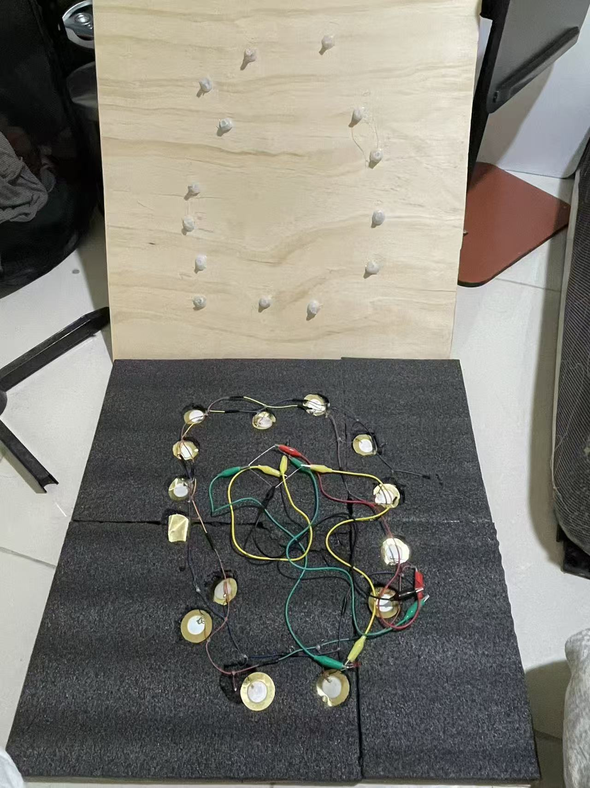
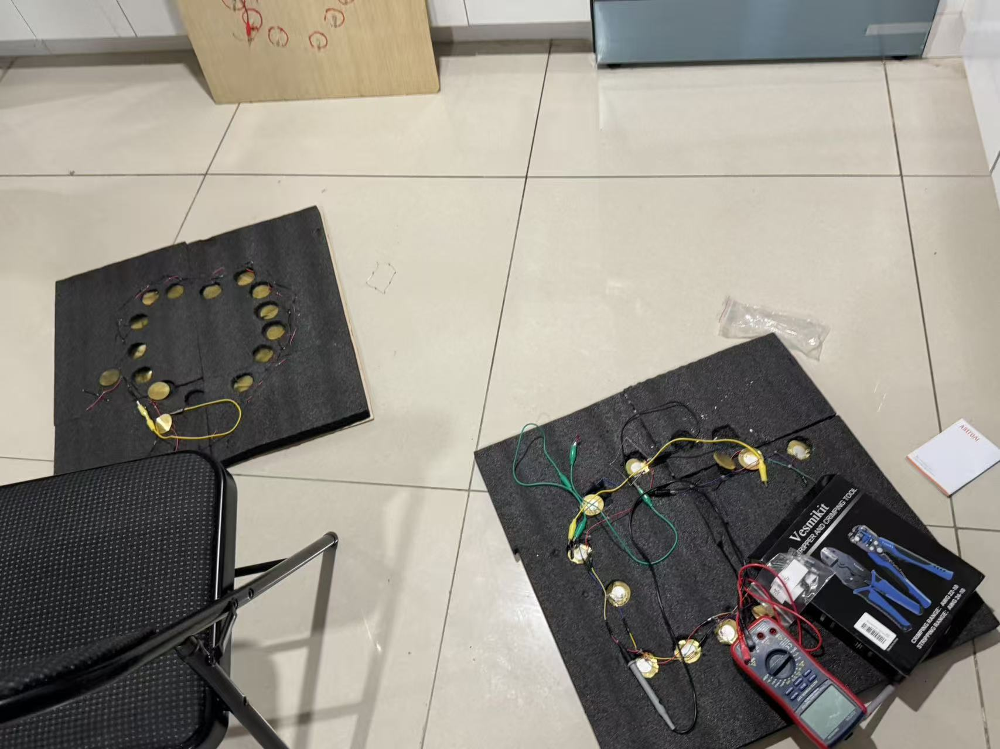
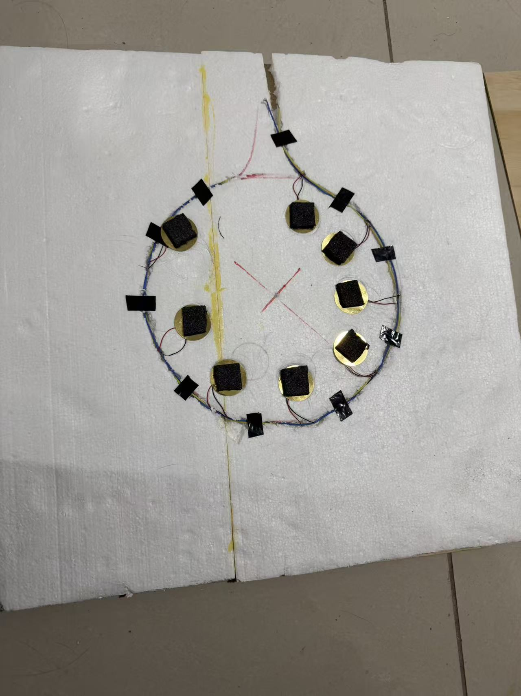
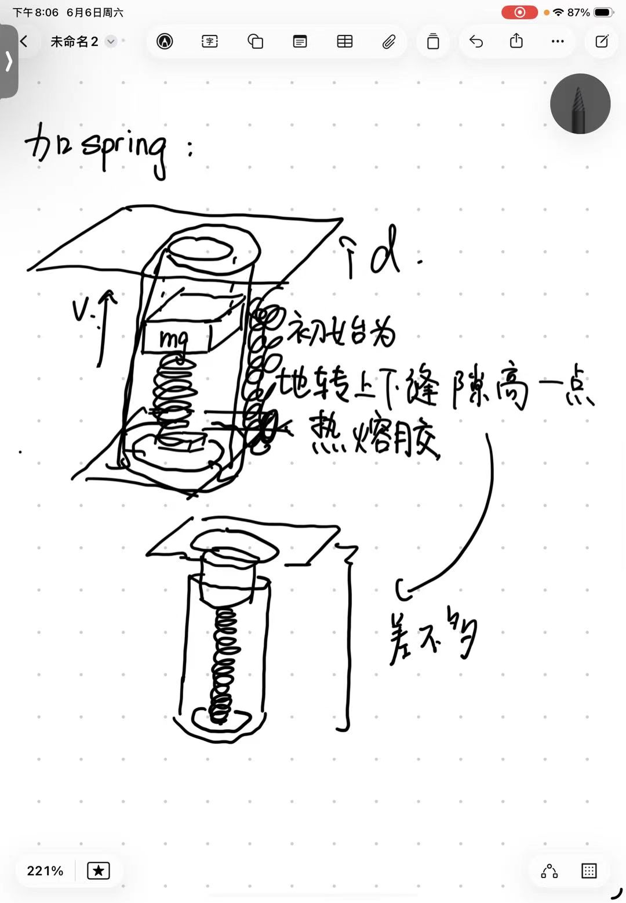
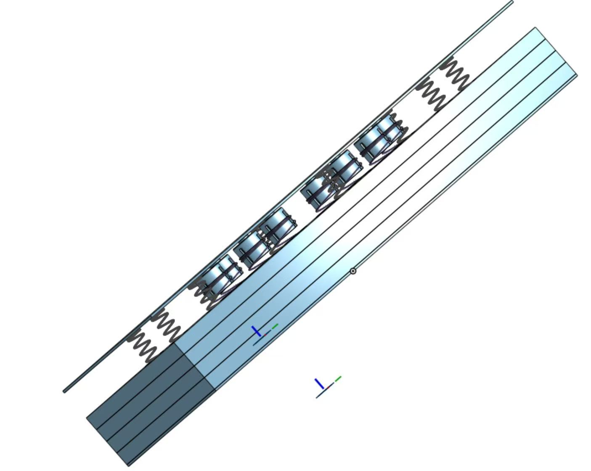
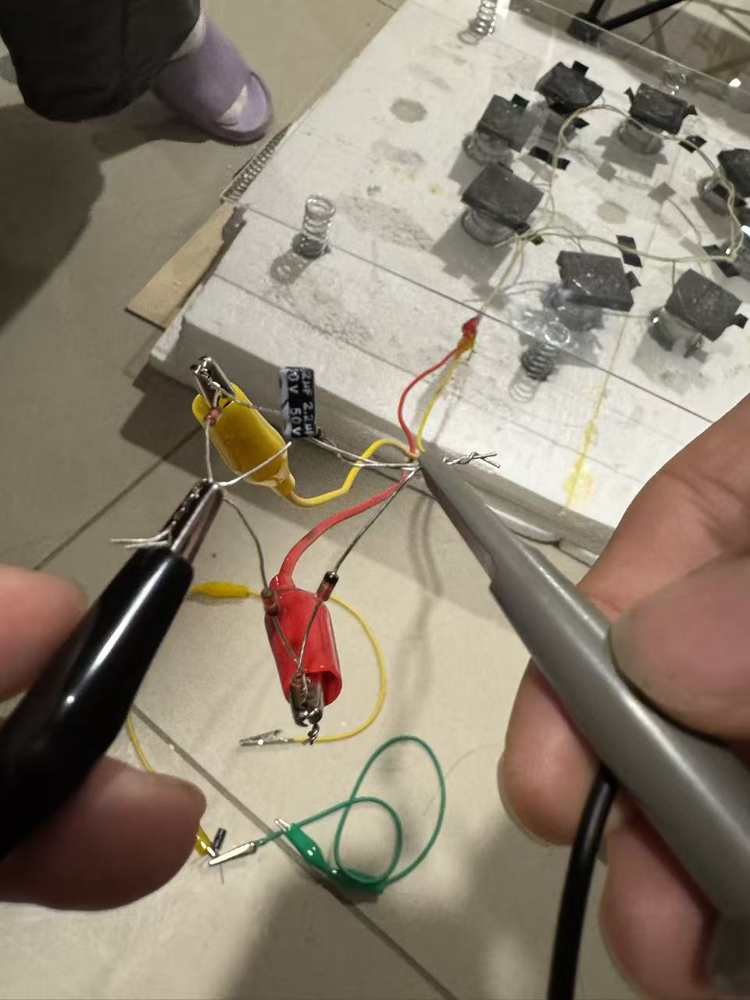
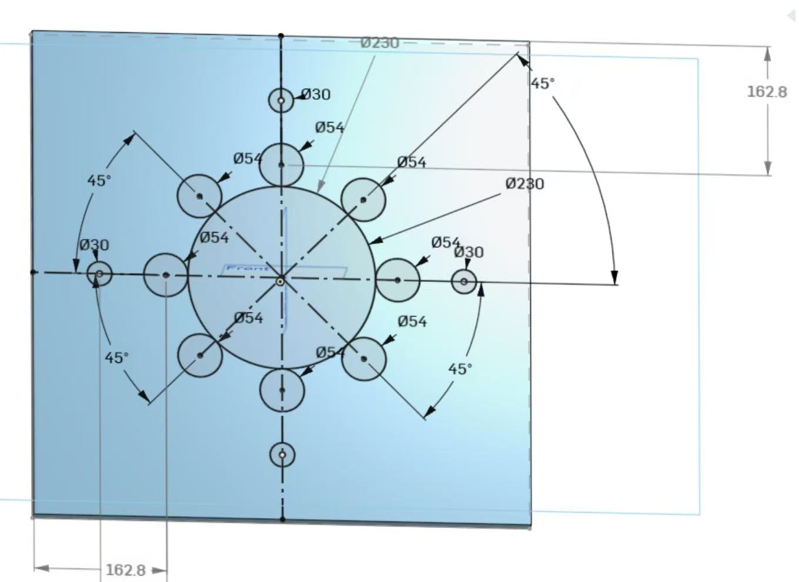
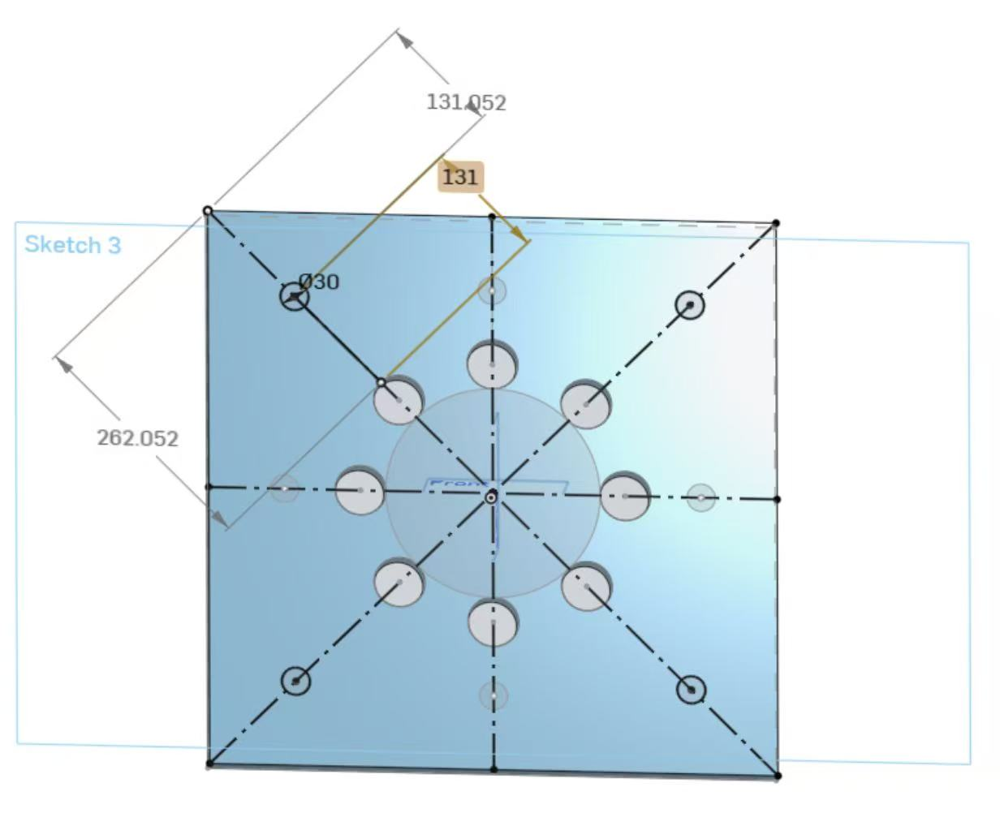
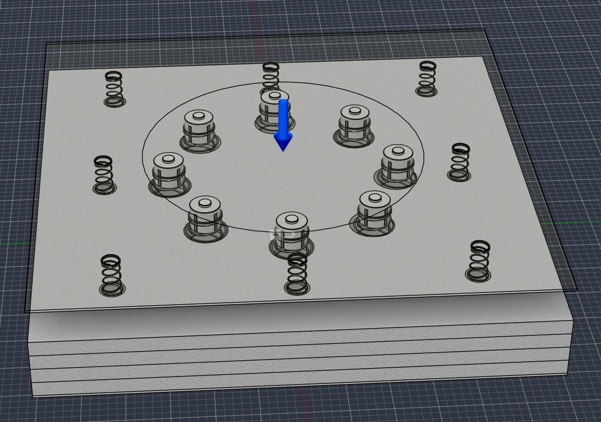

# Piezoelectric Floor Tile

An experimental footstep energy-harvesting project by **Shaoxuan Xiong, Shuoqi Yang, and Wenhao Jia**. Three mechanical designs explore how to load a piezoelectric disc, protect it from damage, and deliver repeatable energy to a storage capacitor.

The project began with a replication of [Selim, Yehia and Saleeb (2024)](https://doi.org/10.1007/s42417-024-01379-z). During our replication, the hot-melt glue-stick contacts deformed and damaged the discs. We replaced those contacts with sponge pads, then developed spring–impactor and center-punch mechanisms.

## Design evolution

| Version | Design change | What we learned |
| --- | --- | --- |
| **V1** | Sponge pads transmit the load to an eight-disc parallel array. | The softer interface followed damage observed with glue-stick contacts. Output also varied with stepping position. |
| **V2** | Spring–impactor modules and separate travel-limiting/return springs allow separation and repeated contact. | The moving plate and impactor produced variable responses. This motivated a more deliberately triggered release. |
| **V3** | A center-punch-style mechanism stores spring energy and releases it at a mechanical trigger. | The mechanism has been printed, assembled, and successfully triggered. V3 is structure **B** in the comparison data. |

### V1: from paper replication to a sponge interface

The first build replicated the reference paper's sandwich structure, using glue-stick contacts to apply local pressure to the piezoelectric discs. In our build, these contacts deformed and damaged the discs. We replaced them with sponge pads to distribute the contact load more gently. The image gallery below preserves the initial glue-contact attempt as V1a and the revised sponge build as V1b.

The original V1 tile used **eight piezoelectric discs connected in parallel**. Historical tests covered center and edge stepping, voltage waveforms, LED loading, and capacitor charging/discharging. Output varied with stepping position. These historical photographs and measurements describe the eight-disc tile.

For the later A/B comparison, we built **A as a separate, single-disc adaptation of V1** to match B's disc count. Its measurements were taken from that single-disc structure; they were not obtained by dividing the eight-disc output by eight.

### V2: spring–impactor modules and inconsistent transfer

V2 introduced spring–impactor modules with separate travel-limiting/return springs. The full tile contained eight modules beneath an acrylic upper plate. The intended sequence was to compress the module spring during loading, allow separation during unloading, and let the impactor catch up with the plate for further contact events.

Testing showed substantial step-to-step variation, with voltage often falling rapidly after the first compression. Through the transparent acrylic plate, we observed interacting motions of the moving upper plate and the internal spring–impactor assembly. Greater internal flexibility also meant that the two moving parts did not consistently transfer energy to the piezoelectric disc at the intended time.

Our interpretation was that poorly synchronized motion diverted energy into other mechanical motion and losses, making the piezoelectric response inconsistent. This observation motivated V3. It was not a measured energy balance: opposing motions alone do not destroy energy, and the contributions of recoil, damping, friction, deformation, and contact timing were not separately quantified.

The V2 Python simulation screened separation and re-impact events using prescribed floor displacement. Because the plate did not respond to the impactor in that model, it supported mechanical candidate selection but did not verify the proposed two-way coupling explanation or predict electrical output. The simulation's `measured_v3` filenames identify a V2 analysis revision, not the V3 device.

### V3: storing spring energy and triggering its release

V3 uses a center-punch-style trigger. A relatively slow stepping input compresses the springs; alignment at the trigger releases the moving assembly and delivers a short contact event to the piezoelectric disc. The aim is to make impact delivery depend more on the mechanical release state and less on the uncontrolled relative motion observed in V2.

The mechanism has been **printed, assembled, and successfully triggered**. **B in the A/B dataset is this single-disc V3 structure.** Its capacitor measurements are summarized below.

The contact-force calculation uses contact speed, effective moving mass, and equivalent contact stiffness. These inputs have not been calibrated by measurements, so successful triggering and capacitor charging do not establish a measured peak force or constant-force output. The existing mechanism animation illustrates the release sequence; it is separate from a physical impact recording.

The current A/B experiment compares the single-disc V1-derived structure with V3. It does not measure a V2-to-V3 performance ratio or reproduce the reference paper's power test.

[Supporting design notes](docs/design-evolution.md) · [V2 simulation and results](simulation/v2/README.md) · [V3 contact-force method](docs/process-reports/v3-center-punch-contact-force-method.pdf)

## A/B experiments

**A is a single-disc adaptation of V1; B is the single-disc V3 structure.** A was reduced to one disc to match B's piezo count. The original eight-disc V1 tile is a separate historical configuration.

The same operator used the same shoes and stepping location, alternating A/B under normal stepping. Disc model, rectifier bridge, and post-step waiting time matched. The **4.7 μF** capacitor was discharged before each single-step trial. Quasi-open-circuit voltage was measured **before rectification**, with matching oscilloscope/probe attenuation settings.

### Overall results

All entries below are **arithmetic mean ± sample standard deviation (SD)**. The sample count applies separately to A and B.

| Measurement | A · V1-derived | B · V3 | Records per structure |
| --- | ---: | ---: | --- |
| Single-step capacitor energy (μJ) | **11.63 ± 6.35** | **72.48 ± 12.85** | 100 steps, 5 groups of 20 |
| Quasi-open-circuit Vpp (V) | 40.15 ± 3.89 | 94.93 ± 16.69 | 60 steps, 3 groups of 20 |
| Capacitor energy after 5 steps (μJ) | 70.97 ± 17.48 | 610.45 ± 73.39 | 5 charging runs |
| Capacitor energy after 10 steps (μJ) | 174.54 ± 45.14 | 896.04 ± 86.59 | 5 charging runs |
| Capacitor energy after 20 steps (μJ) | 348.65 ± 57.82 | 1484.62 ± 104.98 | 5 charging runs |

**B's mean single-step stored energy was 6.23 times A's**, equivalent to a **523.3% increase relative to A**. Relative single-step variability, measured as SD/mean, was **54.6% for A and 17.7% for B**. B had higher mean total storage at each tested multi-step count, and mean total storage increased from 5 to 20 steps for both structures. The multi-step entries are **total energy after the stated number of steps**, not energy per step.

### How the overall data were analyzed

Capacitor energy was calculated as

$$
\Delta E_C=\frac{1}{2}C\left(V_1^2-V_0^2\right),\qquad C=4.7\mu\mathrm{F}.
$$

With voltage in volts, energy in μJ is `2.35 × (V1² − V0²)`. This measures the increase in stored capacitor energy during the reading window. Quasi-open-circuit Vpp is a voltage metric measured under a different electrical condition; it is not a delivered-energy or power measurement.

For each structure, all **100 single-step records** were pooled across the five worksheet groups, and all **60 quasi-open-circuit records** were pooled across three groups. Each multi-step mean and SD uses its five charging runs. The mean is the sum divided by the record count; sample SD uses the `n − 1` denominator and describes the spread of the individual records, not the uncertainty of the mean. No records were excluded. The chart's error bars show sample SD.

Statistics use the workbook's **displayed trial values captured on November 4, 2026**. Energy summaries use the copied energy cells, rather than recalculating from rounded voltage displays. The separate formula review shows that rounded-voltage calculation and its rounding bounds. This snapshot does not preserve the source workbook's hidden precision or original formulas. The source's older “条件” summary differs from the current trial blocks; the results above were recomputed from the labeled blocks and reconciled with the repository's summary CSV.

Travel and stepping speed were neither controlled nor recorded, and mechanical input work was not measured. These results describe storage under the tested normal-stepping conditions; the **6.23 ratio is not a conversion-efficiency ratio**. Repeated steps from one operator are not independent participants, and matching worksheet rows do not establish paired A/B observations. The lower relative spread for B describes this dataset and does not establish repeatability under controlled equal mechanical input.

[Detailed test conditions](docs/experiments.md) · [Trial data and dictionary](data/README.md) · [Summary CSV](data/ab-comparison/summary.csv) · [Formula review workbook](data/ab-comparison/ab-formula-review-2026-11-05.xlsx)

## Explore the project

| Material | Location |
| --- | --- |
| CAD meshes and original V2 assembly download | [cad/](cad/README.md) |
| Structure photos, sketches, and CAD views | [assets/images/](assets/images/README.md) |
| Mechanism, structural-simulation, and LED videos | [assets/videos/](assets/videos/README.md) |
| A/B trial snapshots and reproducible summary | [data/](data/README.md), [analysis/](analysis/README.md) |
| V2 mechanical simulation, six displacement inputs, and recorded results | [simulation/v2/](simulation/v2/README.md) |
| Chinese laboratory summaries and process reports | [docs/process-reports/](docs/process-reports/README.md) |
| Full V2 CAD and historical V1/V2 measurement archive | [Project archive release](https://github.com/yuxuan-518/piezoelectric-floor-tile/releases/tag/project-archive-2026-11-04) |

## Contributors

### Shaoxuan Xiong

- As the first author of the project manuscript and research lead, I led the development of the research idea, workflow, and methods, and coordinated the project's experimental and analytical work.
- I was responsible for early circuit assembly, capacitor selection, and V1/V2 measurements, assessed data quality and the plausibility of the results, and led the overall data analysis.
- During V2 development, I led mechanism development, Python simulation, and spring-parameter selection, and revised and checked the physical model assembled by Shuoqi Yang.
- During the V3 stage, I reviewed the data independently collected by Wenhao Jia and Shuoqi Yang and completed all data analysis and figure preparation.
- For the manuscript, I established the overall structure and line of argument, then revised, integrated, and refined the initial draft to produce the final manuscript.

### Shuoqi Yang

- Participated in measuring, recording, and transcribing V2 and V3 experimental data, and analyzed the V2 data by organizing the measurements and comparing output across tests to support subsequent structural revisions and discussion of the results.
- For the V2 motion study, measured and transcribed the displacement of the upper wooden plate driven by footsteps, providing measured motion inputs for simulation.
- Was responsible for CAD modeling of V2 modular components, representing the mechanical parts and their structural relationships for assembly and design discussions.
- In the V3 stage, led the organization of the physical formulas, including the quantities and relationships used to analyze mechanism motion and contact forces.
- Also carried out circuit connection and soldering to support prototype construction and experimental measurements.

### Wenhao Jia

- Wrote the first manuscript draft according to the established outline, organizing the design evolution, experimental methods, and research results into initial sections for subsequent discussion and revision.
- Participated in measuring and recording V2 and V3 experimental data and assisted with transcription.
- For the V2 motion study, recorded and transcribed displacement measurements of the upper wooden plate driven by footsteps to support subsequent data processing and simulation.
- Was responsible for V2 CAD assembly modeling, bringing the component models together into a complete assembly, and produced force-analysis animations to illustrate structural relationships and loading.
- In the V3 stage, participated in collaborative mechanism design and carried out the related CAD modeling and motion-animation work to illustrate the mechanism's motion and triggered release.

[Detailed contributions and attribution](CREDITS.md).

## Reference

Selim, K. K., Yehia, H. M., & Saleeb, D. A. (2024). *Energy Harvesting Floor Tile Using Piezoelectric Patches for Low-Power Applications*. Journal of Vibration Engineering & Technologies, 12, 8613–8622. [doi:10.1007/s42417-024-01379-z](https://doi.org/10.1007/s42417-024-01379-z). Performance reported in that paper belongs to its prototype and is not presented as our measured output.

## Build photos and design images

### V1: replication and sponge revision

The first two images document the initial glue-contact build. The next two show the revised sponge interface and the historical eight-disc tile.

<table>
  <tr><th>V1a · Glue-contact top plate</th><th>V1a · Glue contacts and foam layout</th></tr>
  <tr>
    <td></td>
    <td></td>
  </tr>
  <tr><th>V1b · Eight discs and sponge pads</th><th>V1b · Sponge sandwich tile</th></tr>
  <tr>
    <td></td>
    <td></td>
  </tr>
</table>

### V2: design, assembly, and structural analysis

<table>
  <tr><th>Concept sketch</th><th>CAD module layout</th></tr>
  <tr>
    <td></td>
    <td></td>
  </tr>
  <tr><th>CAD section</th><th>Assembled tile and circuit</th></tr>
  <tr>
    <td></td>
    <td></td>
  </tr>
  <tr><th>Module hole dimensions</th><th>Limiting-spring hole dimensions</th></tr>
  <tr>
    <td></td>
    <td></td>
  </tr>
  <tr><th colspan="2">Structural-analysis setup</th></tr>
  <tr><td colspan="2"></td></tr>
</table>

### V3: center-punch section drawing

This is a mechanism drawing; a physical-build photograph is not included in the current image archive.

