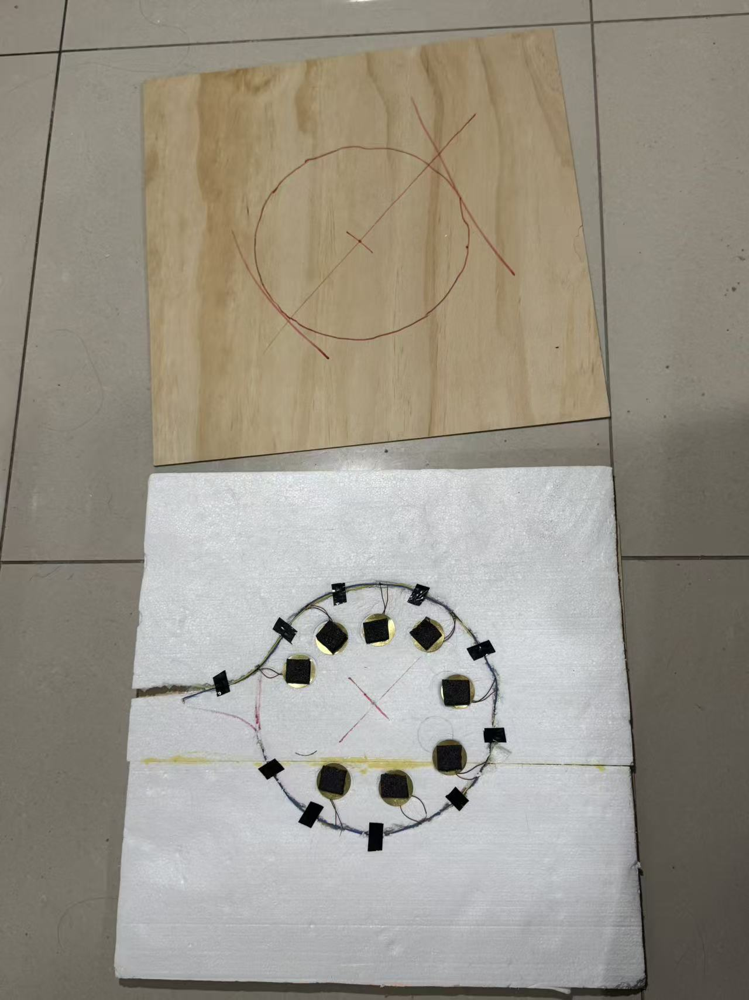
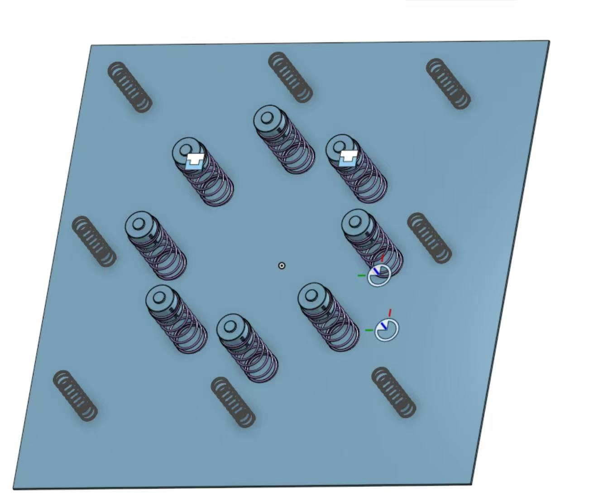
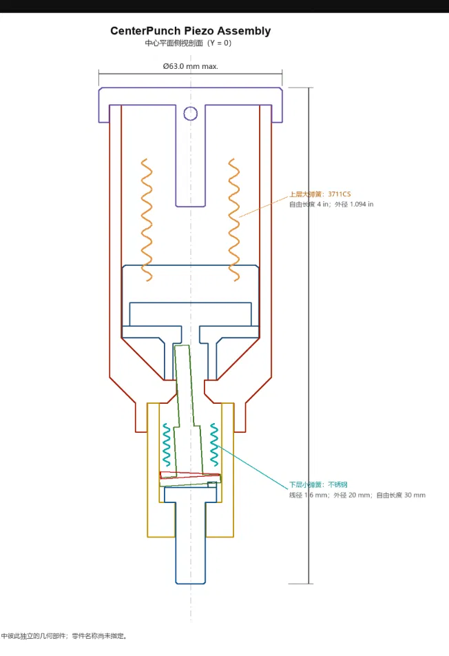
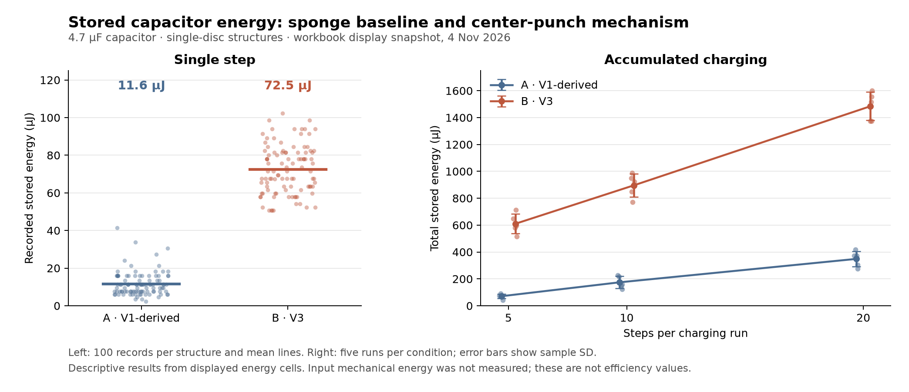

# Piezoelectric Floor Tile

An experimental footstep energy-harvesting project by **Shaoxuan Xiong, Shuoqi Yang, and Wenhao Jia**. Three mechanical designs explore how to load a piezoelectric disc, protect it from damage, and deliver repeatable energy to a storage capacitor.

The project began with a replication of [Selim, Yehia and Saleeb (2024)](https://doi.org/10.1007/s42417-024-01379-z). During our replication, the hot-melt glue-stick contacts deformed and damaged the discs. We replaced those contacts with sponge pads, then developed spring–impactor and center-punch mechanisms.

## Three design iterations

<table>
  <tr><th>V1 · Sponge sandwich</th><th>V2 · Spring–impactor</th><th>V3 · Center punch</th></tr>
  <tr>
    <td></td>
    <td></td>
    <td></td>
  </tr>
</table>

| Version | Design change | What we learned |
| --- | --- | --- |
| **V1** | Sponge pads transmit the load to an eight-disc parallel array. | The softer interface followed damage observed with glue-stick contacts. Output also varied with stepping position. |
| **V2** | Spring–impactor modules and separate travel-limiting/return springs allow separation and repeated contact. | The moving plate and impactor produced variable responses. This motivated a more deliberately triggered release. |
| **V3** | A center-punch-style mechanism stores spring energy and releases it at a mechanical trigger. | The mechanism has been printed, assembled, and successfully triggered. V3 is structure **B** in the comparison data. |

[Design development and observations](docs/design-evolution.md) · [CAD downloads](cad/README.md) · [Videos](assets/videos/README.md)

## A/B experiments

**A is a single-disc adaptation of V1; B is the single-disc V3 structure.** A was reduced to one disc to match B's piezo count. The original eight-disc V1 tile is a separate historical configuration.

The comparison uses a **4.7 μF** storage capacitor. It is discharged before each single-step trial. Quasi-open-circuit voltage is measured **before rectification**, and the team confirmed matching oscilloscope/probe attenuation settings.

The current data-sheet snapshot gives:

| Measurement | A · V1-derived | B · V3 | Records per structure |
| --- | ---: | ---: | ---: |
| Single-step stored energy, mean ± sample SD | **11.6 ± 6.3 μJ** | **72.5 ± 12.8 μJ** | 100, in 5 groups of 20 |
| Quasi-open-circuit Vpp, mean ± sample SD | 40.2 ± 3.9 V | 94.9 ± 16.7 V | 60, in 3 groups of 20 |

These are descriptive results from the workbook's **displayed values**, copied on November 4, 2026. The mean recorded single-step stored energy for B is about **6.23 times** A's. This ratio concerns capacitor energy under these tests; mechanical input energy was not measured, so it is not an efficiency ratio.

The workbook's older “条件” summary differs from its current data sheets. This repository recomputes its summary from the labeled trial blocks and documents the discrepancy. [Measurement method and limitations](docs/experiments.md) · [CSV snapshots and data dictionary](data/README.md) · [Live source workbook](https://1drv.ms/x/c/ec731eaab7075a35/IQBu0pYTxfz4QIeSvFwY5F9VATk93ZKyLGgmgde4zelluMU)

## Explore the project

| Material | Location |
| --- | --- |
| CAD meshes and original V2 assembly download | [cad/](cad/README.md) |
| Structure photos, sketches, and CAD views | [assets/images/](assets/images/README.md) |
| Mechanism, structural-simulation, and LED videos | [assets/videos/](assets/videos/README.md) |
| A/B trial snapshots and reproducible summary | [data/](data/README.md), [analysis/](analysis/README.md) |
| V2 mechanical simulation, six displacement inputs, and recorded results | [simulation/v2/](simulation/v2/README.md) |
| Chinese laboratory summaries and process reports | [docs/process-reports/](docs/process-reports/README.md) |
| Full V2 CAD and historical V1/V2 measurement archive | [Project archive release](https://github.com/yuxuan-518/piezoelectric-floor-tile/releases/tag/project-archive-2026-11-04) |

The V2 simulation screens separation and re-impact mechanics. Its `measured_v3` filenames refer to a **data-processing revision of the V2 analysis**, not the V3 center-punch device.

## Contributors and reference

- **Shaoxuan Xiong:** primary contributor across project development, physical experimentation, data work and analysis, and review/revision of the paper; co-developed the physical-model equations.
- **Shuoqi Yang:** 3D modeling and CAD; co-developed the physical-model equations with Shaoxuan Xiong.
- **Wenhao Jia:** primary paper drafting, followed by review and revision by Shaoxuan Xiong.

Full attribution: [CREDITS.md](CREDITS.md).

Selim, K. K., Yehia, H. M., & Saleeb, D. A. (2024). *Energy Harvesting Floor Tile Using Piezoelectric Patches for Low-Power Applications*. Journal of Vibration Engineering & Technologies, 12, 8613–8622. [doi:10.1007/s42417-024-01379-z](https://doi.org/10.1007/s42417-024-01379-z). Performance reported in that paper belongs to its prototype and is not presented as our measured output.
