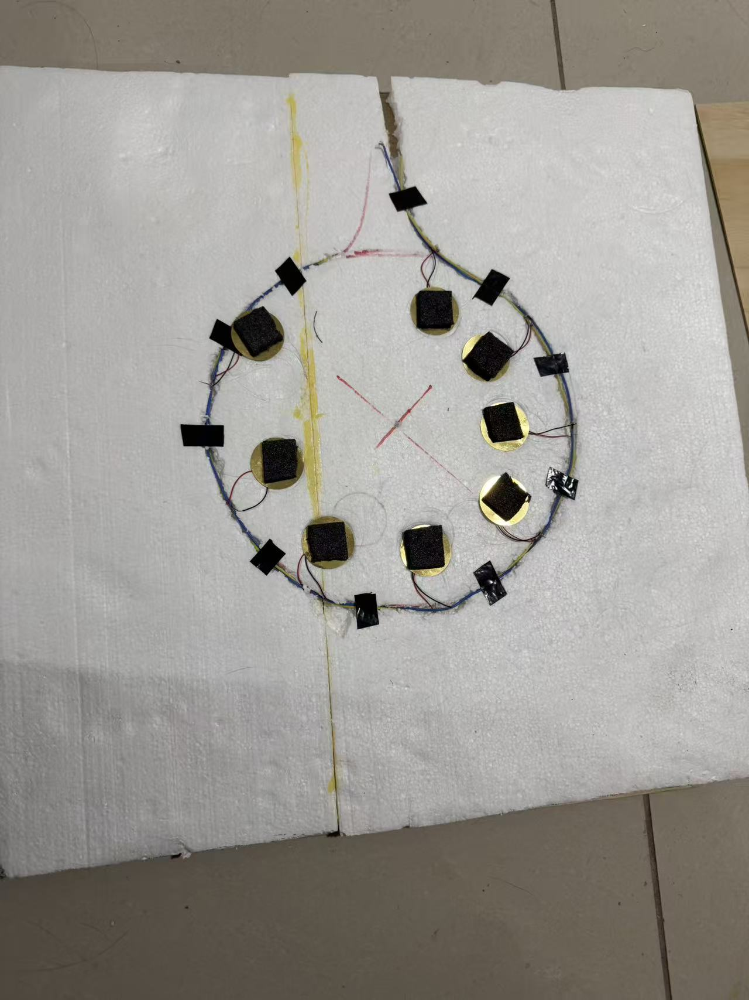
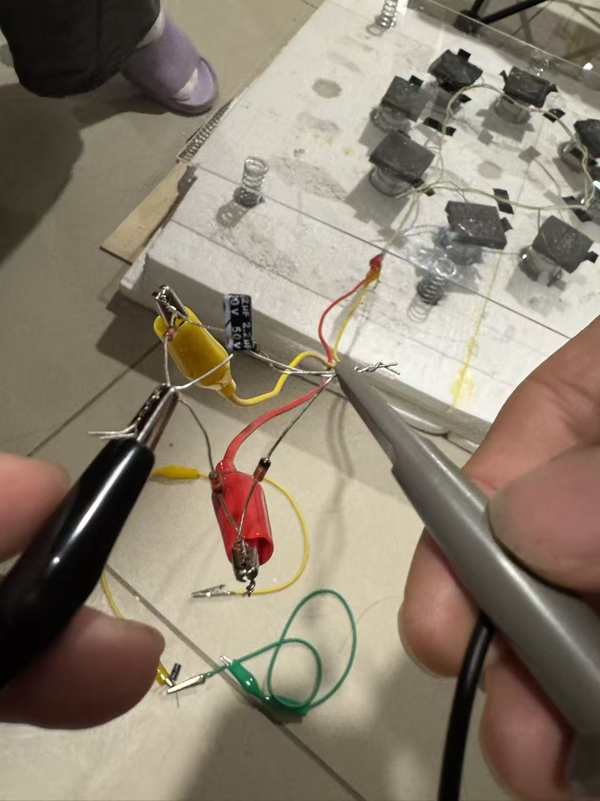
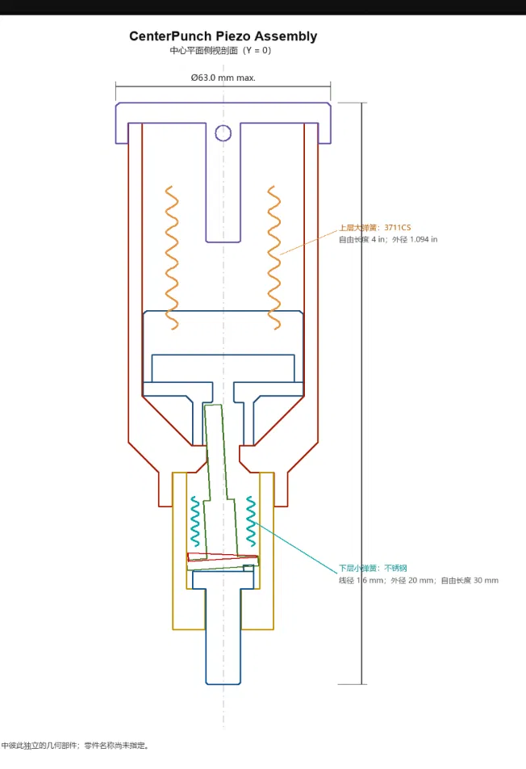

# Design development

## Starting point: paper replication

The starting reference is [Selim, Yehia and Saleeb (2024)](https://doi.org/10.1007/s42417-024-01379-z). Its sandwich structure uses hot-melt glue sticks to apply local pressure to the piezoelectric patches. Its published dimensions, power, and load results describe the reference prototype.

During this team's replication, the glue-stick contacts deformed and damaged the piezoelectric discs. This was an observation in our build, rather than a claim that every implementation of the published design fails. We changed the force-transmission interface to sponge.

## V1: sponge sandwich

The original V1 floor build used **eight piezoelectric discs connected in parallel**. Sponge pads transmit pressure between the upper plate and the discs. The image archive retains both the initial glue-contact attempt (V1a) and the revised sponge build (V1b) as stages of this first design.

Historical tests include center and edge stepping, quasi/open-circuit waveforms, LED loading, and capacitor charge/discharge observations. The corresponding photographs describe the eight-disc-era tile, and must not automatically be assigned to the later single-disc A comparison.

For the later A/B experiment, the team built **A, a one-disc adaptation of V1**, to match the piezoelectric element count of B. A is the comparison baseline; it is not the eight-disc array divided by eight.

## V2: spring–impactor modules

V2 introduced compliant impactor modules and separate travel-limiting/return springs. The documented full tile contains eight modules beneath an acrylic plate. The intended mechanism was: loading compresses a module spring; unloading permits separation; the impactor may then catch up with the plate and make further contacts.

Testing produced unstable responses: output changed substantially between steps, and in many observations the voltage fell rapidly after the first compression. Through the transparent acrylic plate, the team observed interacting motions of the upper plate and internal spring–impactor structure.

The team's interpretation is that the poorly synchronized motions made energy transfer to the piezoelectric disc inconsistent, with energy diverted into other mechanical motion and losses. This interpretation motivated V3. The available observations do not provide a measured mechanical energy budget. Opposing motions alone do not destroy energy; contact timing, recoil, damping, friction, and material deformation would need measurements to quantify the transfer and dissipation.

The [V2 event-driven simulation](../simulation/v2/README.md) treats plate motion as a prescribed input and does not model the impactor's reaction on the plate. It therefore helps screen possible separation/re-impact events but does not establish the proposed two-way coupling explanation or predict electrical output.

## V3: center-punch release

V3 uses a center-punch-style trigger. A relatively slow input compresses the springs. Alignment at the trigger releases the moving assembly, allowing stored spring energy to produce a short contact event at the piezoelectric disc. The design aims to make impact delivery depend more on the release state and less on the uncontrolled relative motion seen in V2.

The team has printed, assembled, and successfully triggered the mechanism. **B in the A/B workbook is V3.** The included animation illustrates the mechanism; it is not a recording of an instrumented physical test.

The [contact-force method](process-reports/v3-center-punch-contact-force-method.pdf) describes an estimate based on contact speed, moving mass, and equivalent contact stiffness. Until those quantities are measured, it does not give a calibrated peak force. Successful triggering and capacitor charging do not by themselves demonstrate a constant impact force.

## Current comparison

The A/B experiment compares a V1-derived one-disc structure with the V3 one-disc mechanism. It does not compare V2 with V3, nor reproduce the paper's reported power measurement. See the [experiment definitions](experiments.md) and [data snapshot](../data/README.md).
